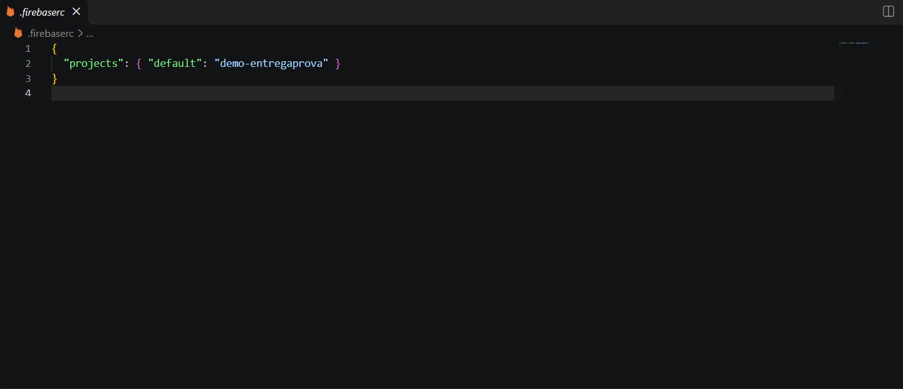
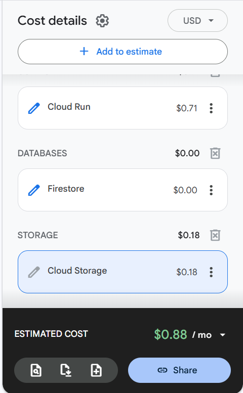

# FinOps: situação de custos

Atualizado em 25/10/2026.

## Situação atual

- O projeto usa o id `demo-entregaprova` (ver `.firebaserc` no repositório de código). É um projeto de demonstração dos emuladores do Firebase: não existe na nuvem e não tem conta de faturamento vinculada.
- O desenvolvimento roda inteiro nos emuladores locais (Auth, Firestore e Storage) via Docker Compose, sem uso de recursos do Google Cloud.
- **Gasto acumulado: US$ 0,00** (teto do Checkpoint 2: US$ 5,00; teto do ciclo: US$ 50,00 por equipe).

## Evidência do gasto (Checkpoint 2)

O guia do Checkpoint 2 pede o print do painel de faturamento. Esse painel não existe para a equipe, porque não há projeto real nem conta de faturamento. O gasto de US$ 0,00 é comprovado por:

- O `.firebaserc` com o id `demo-entregaprova`, prefixo usado apenas por projetos de emulador, que não geram cobrança.
- Todo o ambiente rodando localmente nos emuladores, via Docker Compose.

## Estimativa na calculadora de preços do Google Cloud (fase de nuvem)

Feita em 25/10/2026, na calculadora oficial do Google Cloud, sem conta de faturamento. Região: São Paulo (southamerica-east1). Os valores de uso são estimativas para uma demo pequena, com cerca de 20 usuários.

| Serviço | Uso estimado | Custo mensal |
|---|---|---|
| Cloud Run | 50.000 requisições por mês, tráfego com pico diário, cobrança só durante requisições, instâncias mínimas = 0 | US$ 0,71 |
| Firestore | 5.000 leituras, 500 escritas e 50 exclusões por dia, 1 GiB armazenado | US$ 0,00|
| Cloud Storage | 5 GiB armazenados, 10.000 operações de escrita e 50.000 de leitura por mês, 5 GiB de saída de dados | US$ 0,18 |
| 10.58 | | 0,81 |

Esse valor é uma previsão para a fase de nuvem (a partir do Checkpoint 3). Hoje o gasto real continua em US$ 0,00.

## Pendência: alertas de orçamento (50/80/100%)

Os alertas de orçamento exigem um projeto real com conta de faturamento (plano Blaze), e o Blaze exige o cadastro de um cartão de crédito. Como a equipe ainda não decidiu quem cadastrará o cartão, o projeto real não foi criado e o alerta **não foi criado**. Isso é uma decisão consciente, não um esquecimento.

Plano:

1. O grupo define quem cadastra o cartão e como limitar o risco (por exemplo, cartão virtual com limite baixo), com a validação do tutor. Também será perguntado ao tutor se o curso oferece créditos ou uma conta de faturamento para as equipes.
2. Ao criar o projeto real, criar o orçamento de US$ 50 com alertas em 50%, 80% e 100% (US$ 25, 40 e 50).
3. Registrar aqui o print do console com os limites.

Prazo: antes do Checkpoint 3 (15/11), que exige Cloud Run e, portanto, faturamento.

## Controles previstos para a fase de nuvem

- `min-instances=0` no Cloud Run.
- Listas paginadas e queries controladas.
- Sem listeners grandes sem justificativa.
- Revisão de leituras e escritas do Firestore.

## Evidências

- `.firebaserc` com o id `demo-entregaprova`: ver `print-firebaserc.png` nesta pasta.
- Estimativa da calculadora de preços: ver `estimativa-calculadora.png` nesta pasta.