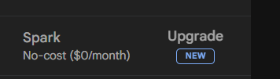
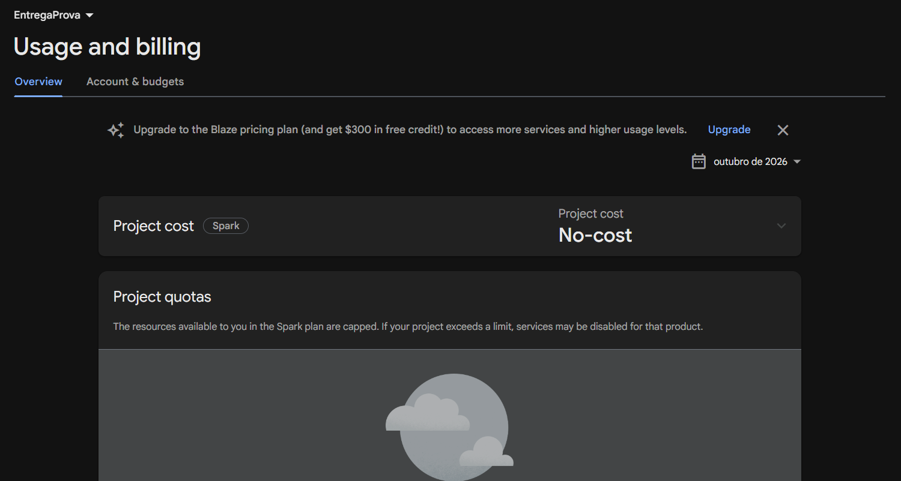
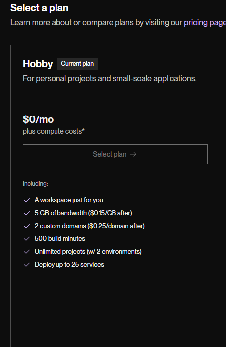
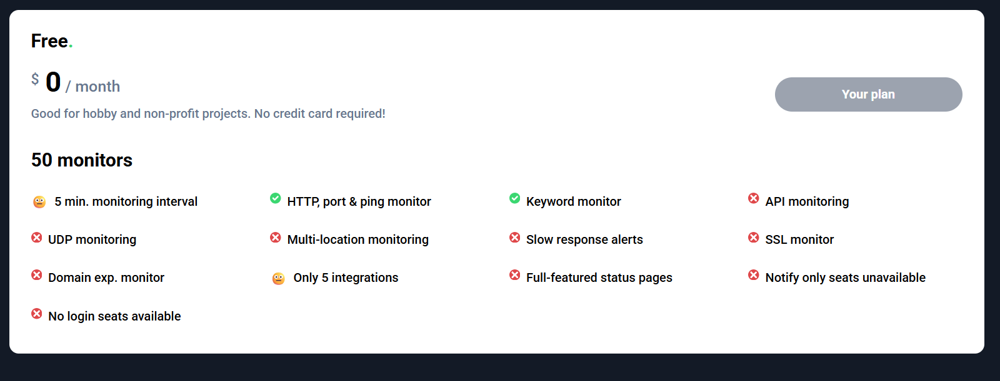
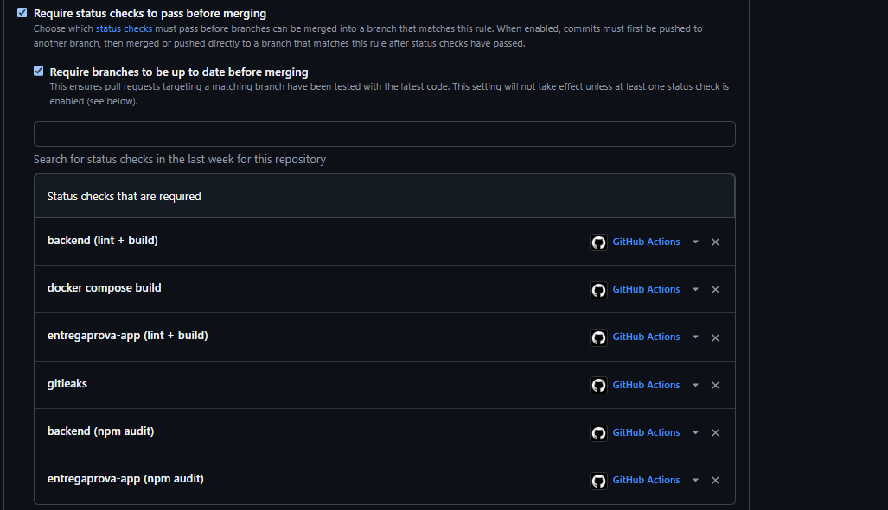

# FinOps: situação de custos

Atualizado em 01/11/2026.

## Situação atual

- O desenvolvimento usa o id `demo-entregaprova` (ver `.firebaserc` no repositório de código). É um projeto de demonstração dos emuladores do Firebase: não existe na nuvem e não tem conta de faturamento vinculada.
- O desenvolvimento roda inteiro nos emuladores locais (Auth, Firestore e Storage) via Docker Compose, sem uso de recursos do Google Cloud.
- O projeto Firebase real da equipe está no plano gratuito **Spark**, sem conta de faturamento e sem cartão cadastrado (evidência na seção seguinte).
- A API está no ar no Render (plano Free), em `https://entregaprova.onrender.com`. O frontend é publicado no Firebase Hosting (plano Spark) por GitHub Actions: preview a cada PR e produção no merge da `main`.
- Monitoramento: o Render faz health check em `/healthz` e o UptimeRobot avisa por e-mail quando a API cai. Nenhum dos dois tem cartão cadastrado.
- **Gasto acumulado: US$ 0,00** (teto do Checkpoint 2: US$ 5,00).

## Evidência do plano Firebase Spark (Checkpoint 2)

O guia do Checkpoint 2 pede o print do painel de faturamento. Como o projeto da equipe está no plano Spark, não existe painel de faturamento com gasto a mostrar. A prova de que não há cobrança possível é mostrar que o projeto está no plano gratuito e que nenhuma conta de faturamento está vinculada a ele. Os dois prints abaixo cumprem esse papel.

**Print A: plano do projeto.** Painel do projeto Firebase da equipe, com o plano **Spark (sem custo, US$ 0 por mês)** visível. O plano Spark não permite cobrança: quando um limite diário é atingido, o serviço para até o dia seguinte e nada é cobrado.

**Print B: ausência de faturamento.** Configurações de uso e faturamento do projeto, mostrando o plano Spark e nenhuma conta de faturamento vinculada. Sem conta de faturamento e sem cartão cadastrado, o pior que pode acontecer é um serviço parar, nunca uma cobrança.

Complementam essa evidência:

- O `.firebaserc` com o id `demo-entregaprova`, prefixo usado apenas por projetos de emulador, que não geram cobrança.
- Todo o ambiente de desenvolvimento rodando localmente nos emuladores, via Docker Compose.

## Evidência do plano gratuito do Render e do UptimeRobot

**Render (API).** Plano **Hobby, US$ 0/mês**, marcado como plano atual. O serviço `EntregaProva` roda na instância **Free**. O custo adicional ("compute costs") só se aplica a instâncias pagas, que não usamos.

**UptimeRobot (monitoramento).** Plano **Free, US$ 0/mês**, 50 monitores, checagem a cada 5 minutos, com a indicação "No credit card required".

**Firebase Hosting.** Não tem plano próprio: usa o do projeto Firebase, que está no Spark (Prints A e B acima).

## Proteção da branch main (repositório de código)

A `main` está protegida: nenhuma alteração entra sem pull request aprovado por outra pessoa e com os checks do CI verdes (lint e build do backend e do frontend, `docker compose build`, gitleaks e `npm audit` do backend e do frontend), com a branch atualizada e sem permissão de force push.

## Estimativa na calculadora de preços do Google Cloud (cenário original com GCP)

Feita em 25/10/2026, na calculadora oficial do Google Cloud, sem conta de faturamento. Região: São Paulo (southamerica-east1). Os valores de uso são estimativas para uma demo pequena, com cerca de 20 usuários.

| Serviço | Uso estimado | Custo mensal |
|---|---|---|
| Cloud Run | 50.000 requisições por mês, tráfego com pico diário, cobrança só durante requisições, instâncias mínimas = 0 | US$ 0,71 |
| Firestore | 5.000 leituras, 500 escritas e 50 exclusões por dia, 1 GiB armazenado | US$ 0,00 |
| Cloud Storage | 5 GiB armazenados, 10.000 operações de escrita e 50.000 de leitura por mês, 5 GiB de saída de dados | US$ 0,18 |
| **Total** | | **US$ 0,89** |

Essa estimativa foi feita para o cenário com Cloud Run e Cloud Storage. Com o Plano Custo Zero, esses serviços não são usados (a API vai para o Render e os arquivos, se necessários, para o Supabase Storage, ambos em plano gratuito), então o custo previsto é US$ 0,00. A estimativa fica registrada como referência do cenário original.

## Alertas de orçamento (50/80/100%): substituídos no Plano Custo Zero

Os alertas de orçamento exigem um projeto com conta de faturamento (plano Blaze), e o Blaze exige o cadastro de um cartão de crédito. Como a equipe não terá voucher do GCP, ela adota o Plano Custo Zero: nenhum projeto liga conta de faturamento e nenhum cartão é cadastrado em nenhum serviço.

Por isso, **os alertas de orçamento não foram criados, e essa é uma decisão consciente, não um esquecimento**. Sem faturamento não há cobrança possível, e os alertas deixam de ser necessários. No lugar deles, a evidência para o tutor é a prova de que não existe faturamento ligado ao projeto, apresentada nos Prints A e B acima.

A decisão formal e a aprovação do professor para as exceções ao Caderno (Render no lugar do Cloud Run, Supabase no lugar do Cloud Storage, entre outras) são registradas em ADR pelo Tech Lead.

## Controles previstos para a fase de nuvem

- Regra de ouro: nunca cadastrar cartão em nenhum serviço e nunca clicar em Upgrade ou Blaze no Firebase.
- Testes pesados e carga apenas nos emuladores locais, para não gastar a cota diária do Firestore.
- Listas paginadas e queries controladas.
- Sem listeners grandes sem justificativa.
- Revisão de leituras e escritas do Firestore.
- Conferência dos limites gratuitos dos serviços antes do primeiro deploy.

## Conferência dos limites gratuitos (31/10/2026)

Antes do primeiro deploy (Checkpoint 3), os limites gratuitos usados pelo Plano Custo Zero foram conferidos de novo nas páginas oficiais dos serviços. Nenhum limite mudou em relação à conferência de 14/10/2026.

| Serviço | Limite gratuito conferido |
|---|---|
| Firebase Hosting (Spark) | 10 GB armazenados e 360 MB de transferência por dia |
| Firestore (Spark) | 1 GiB armazenado; 50 mil leituras, 20 mil escritas e 20 mil exclusões por dia |
| Render (web service Free) | 750 horas por mês por workspace; dorme após 15 min sem tráfego e leva cerca de 1 min para acordar; sem disco persistente |
| UptimeRobot (Free) | 50 monitores, checagem a cada 5 min, alerta por e-mail |

O Firebase Spark declara não exigir método de pagamento. No Render, o plano Hobby (US$ 0/mês) é o plano atual, conforme o print acima. No UptimeRobot, o plano Free indica "No credit card required", também conforme o print acima.

## Evidências

- Plano Spark do projeto Firebase: `firebase-spark-sem-faturamento-a.png` nesta pasta.
- Ausência de conta de faturamento: `firebase-spark-sem-faturamento-b.png` nesta pasta.
- Plano gratuito do Render (Hobby): `render-plano-gratuito.png` nesta pasta.
- Plano gratuito do UptimeRobot (Free): `uptimerobot-plano-gratuito.png` nesta pasta.
- Proteção da branch `main`: `branch-protection-main-codigo.png` nesta pasta.
- `.firebaserc` com o id `demo-entregaprova`: `print-firebaserc.png` nesta pasta.
- Estimativa da calculadora de preços (cenário original): `estimativa-calculadora.png` nesta pasta.